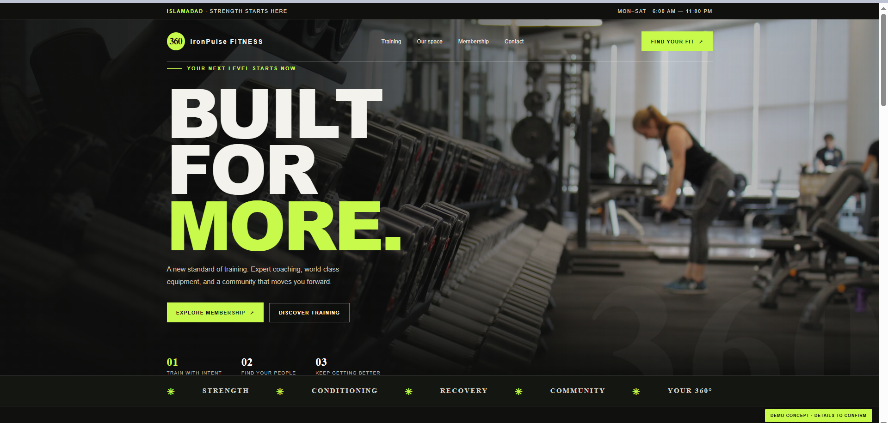

# 🏋️‍♀️ IronPulse Fitness

A modern, responsive website concept for a gym, built with HTML and CSS.

## ✨ Features

- Dark design with lime-green accents
- Responsive layout for desktop and mobile
- Sections for training programs, the gym, and membership plans
- Contact buttons and WhatsApp link
- Demo label to show that this is a sample concept

------------------------------------

## Project files

- `index.html` — website content and page structure
- `style.css` — styles for the website

----------------------------------

## Before using this for a real gym

This is an unofficial demo concept. Replace the sample contact details, address, hours, and membership information with details confirmed by the gym. Get the owner’s approval before presenting it as the gym’s official website.

----------------------------------------------

## Live demo 🌐

[Click here for live demo]()

---------------------------------------

## Screenshots
 
-  **Home page**


------------------------------------------

## Clone the Repository 
```bash 
git clone https://github.com/Amnaakhtar1213/IronPulse-Fitness.git
